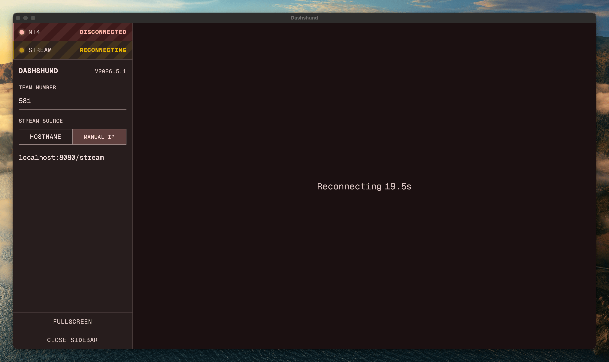

# Dashshund

FRC dashboard for viewing camera streams for [Team 581](https://team581.com/). Built with Tauri, SolidJS, and Tailwind CSS.

Connects to the robot via NetworkTables (NT4) and displays camera streams.



## Installing

Install with Brew:

```sh
brew install jonahsnider/frc/dashshund
```

Or you can download the latest release from the [GitHub releases page](https://github.com/jonahsnider/dashshund/releases/latest).

## Development

```sh
# Install the tool versions declared by the project (requires mise)
mise install

# Install dependencies
pnpm install

# Run the dev server
pnpm dev

# Run a full build
pnpm build
```

Run `pnpm format`, `pnpm lint`, `pnpm exec fallow`, and `pnpm build:frontend` for the checks used in CI.
Use `pnpm format:fix` and `pnpm lint:fix` to apply automatic fixes.
